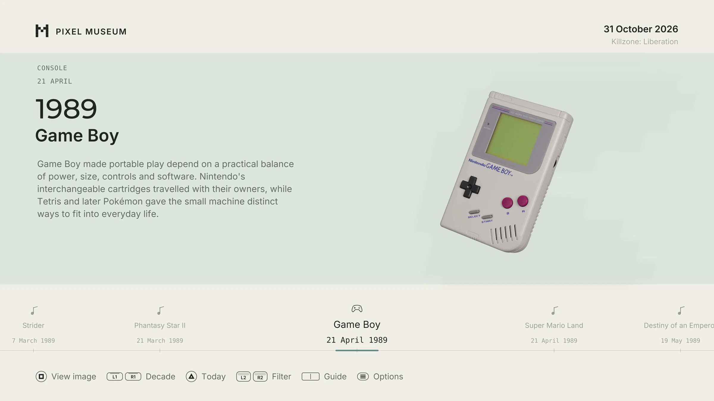
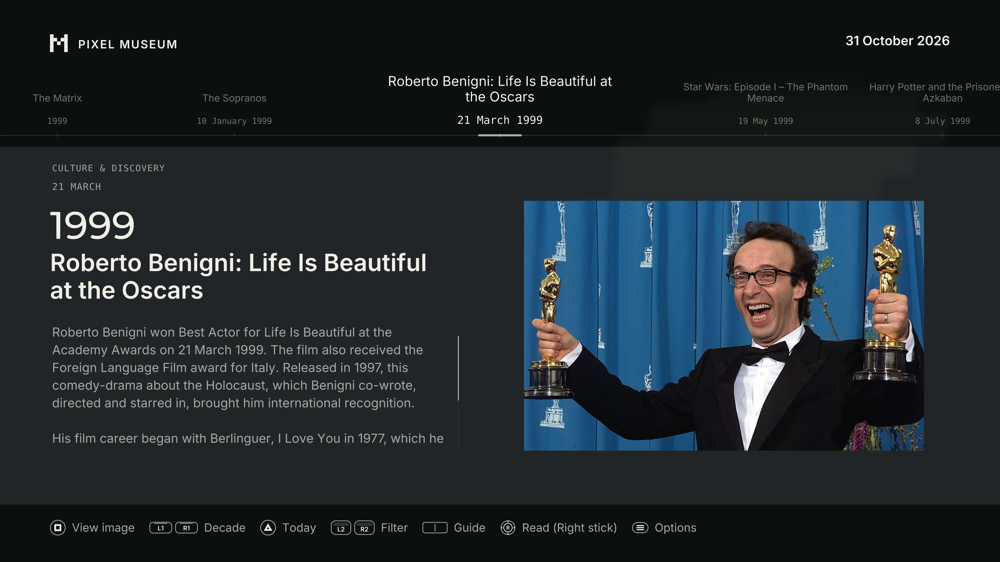
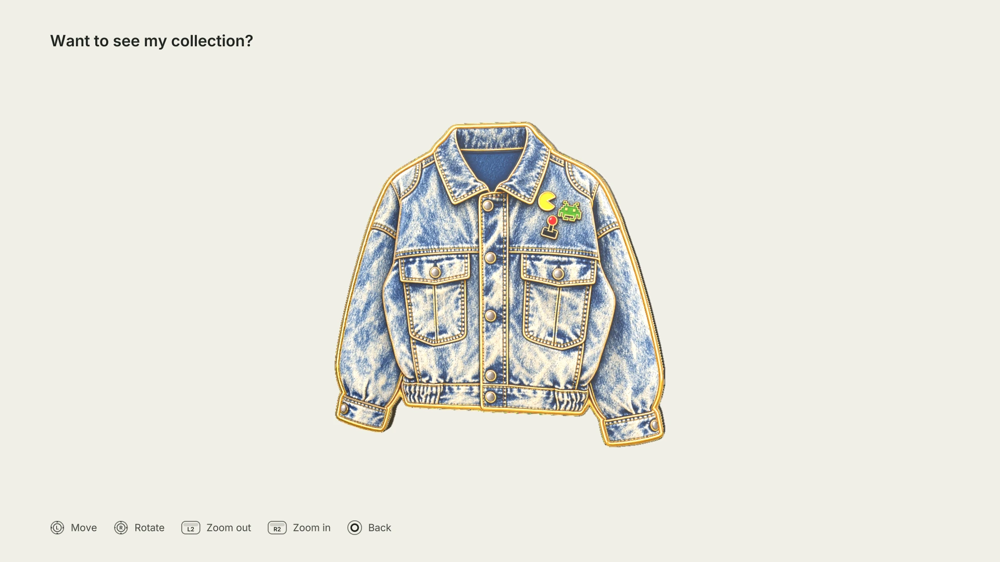

The games we played. The world we grew up in. An independent, interactive museum for PS5.


**[Visit the website](https://lozazamastro.github.io/Pixel-Museum/) · [Download Pixel Museum](https://github.com/LoZazaMastro/Pixel-Museum/releases/latest)**

Pixel Museum brings the history of video games together with the world around them. One timeline follows games, consoles, computers, creators and studios; the other explores films, music, art and historical events from the same years. Open an exhibit to read its story, look through photographs and artwork, or watch a related film.

## Inside the museum

- **Listen to the collection.** Explore game soundtracks, cultural recordings and voices from the past, alongside an original ambient score.
- **Build your own collection.** Discover collectible pins and inspect them in 3D, rotating and zooming in to see their details.
- **Try the ideas yourself.** Play short interactive experiences and explore workshops about pixels, sound and the ways games work.
- **Choose your setting.** Browse in light or dark mode, with English, Italian, French, German and Spanish available.
- **Adjust the sound.** Set separate levels for master volume, sound effects, ambient music, cultural recordings and the controller speaker. Cultural audio can also play through the DualSense speaker.







## Installation

You need a homebrew-enabled PS5 and a compatible homebrew launcher. The extracted application takes approximately **11.49 GB**. YouTube videos and streamed soundtracks require an internet connection.

1. Open the [latest release](https://github.com/LoZazaMastro/Pixel-Museum/releases/latest) and download **all six numbered archive parts** into the same folder. Keep their names unchanged.
2. Open `Pixel-Museum-PPSA70421-20261031.7z.001` with **7-Zip** and extract it. The remaining parts are read automatically; do not extract them separately.
3. Close Pixel Museum on the PS5 if you are updating an existing installation.
4. Using FTP, copy the extracted `PPSA70421` folder into `/data/homebrew/`, preserving its contents and subfolders. The resulting path is `/data/homebrew/PPSA70421/`.
5. Open your homebrew launcher and launch Pixel Museum.

This release is a complete homebrew folder, rather than a retail PKG installer. `INSTALL.txt` and `SHA256SUMS.txt` are included with the release for installation guidance and download verification.

## Support the project

Pixel Museum is free. It has taken months of research, writing, design and development to bring the collection together. If you enjoy exploring it and would like to support that work, [you can contribute on Ko-fi](https://ko-fi.com/lozazamastro).

## Source

This repository contains the application source, tooling and editorial datasets. Large datasets are stored as gzip archives, listed in [`source-data.json`](source-data.json). Restore them before working with the catalogue:

```sh
python tools/restore-source-data.py
```

The ready-to-run binaries and packaged media are supplied separately through [Releases](https://github.com/LoZazaMastro/Pixel-Museum/releases/latest). Machine-specific SDK/toolchain installations, personal settings and local development caches are not included.

## Credits and licences

Design, editorial direction, development, graphics and original music: **Andrea Sgarro / LoZazaMastro**.

The interface builds on **ps5-homebrew-ui by BlackBearReloaded**. Native YouTube playback adapts [ytps5-sponsorblock by animatian112](https://github.com/animatian112/ytps5-sponsorblock). Their existing copyright and licence notices are preserved.

The application source is distributed under the [GNU General Public License](LICENSE). Third-party code, photographs, artwork, films, recordings, models, fonts and attributed writing retain their respective rights and licence terms; the application’s code licence does not relicense those materials. Sources and attribution are included in the museum, with further notices in [THIRD_PARTY_NOTICES.md](THIRD_PARTY_NOTICES.md) and [`licenses/`](licenses/).

Pixel Museum is an independent project. It is not affiliated with the companies, artists or preservation organizations represented in the collection.
