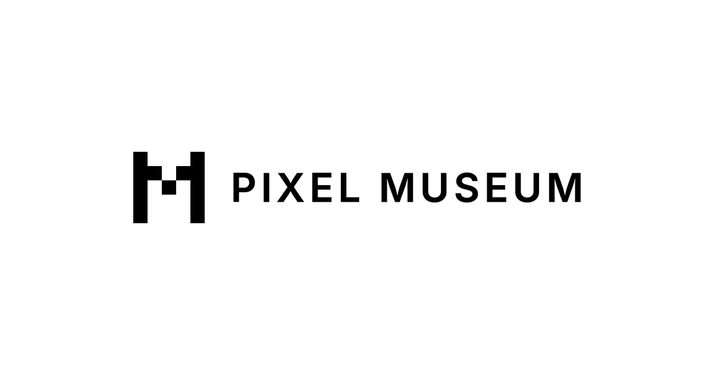
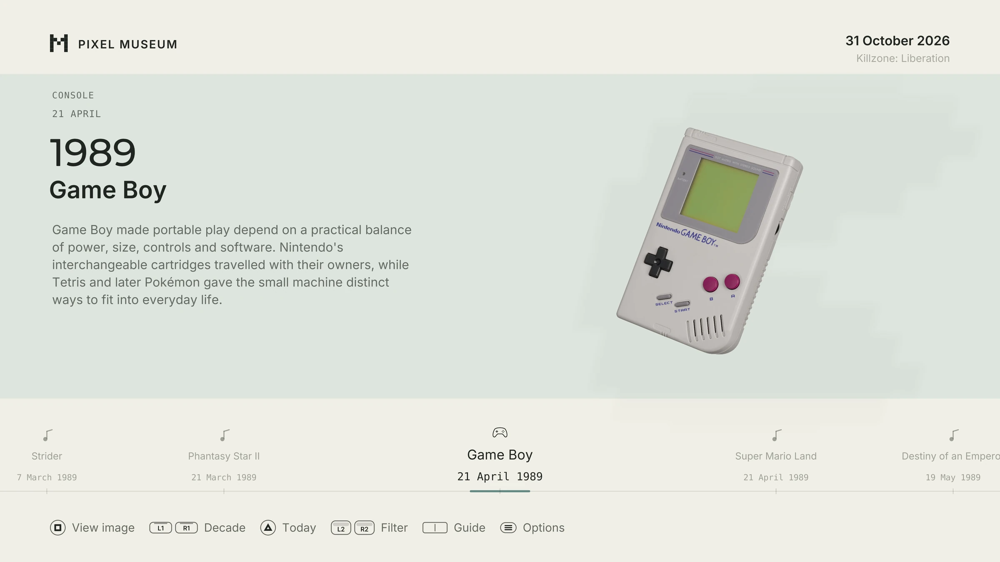
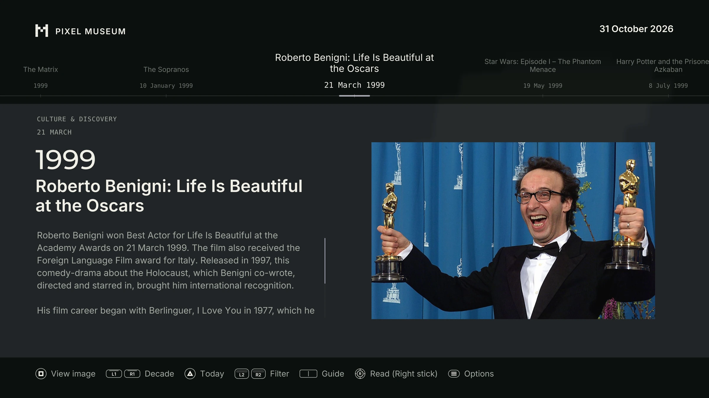
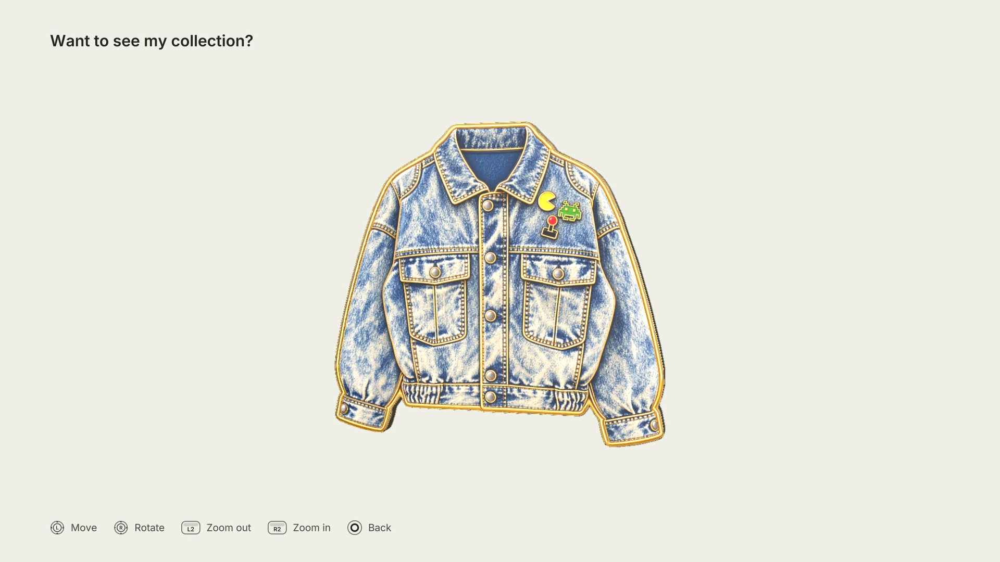

The games we played. The world we grew up in. An independent, interactive museum for Windows and PlayStation 5.



**[Visit the website](https://lozazamastro.github.io/Pixel-Museum/) · [Download for Windows](https://github.com/LoZazaMastro/Pixel-Museum/releases/download/windows-v0.2.0/Pixel-Museum-Setup.exe) ? [Download for PS5](https://github.com/LoZazaMastro/Pixel-Museum/releases/latest/download/PPSA70421.zip)**

Pixel Museum brings the history of video games together with the world around them. One timeline follows games, consoles, computers, creators and studios; the other explores films, music, art and historical events from the same years. Open an exhibit to read its story, look through photographs and artwork, or watch a related film.

## Inside the museum

- **Listen to the collection.** Explore game soundtracks, cultural recordings and voices from the past, alongside an original ambient score.
- **Build your own collection.** Discover collectible pins and inspect them in 3D, rotating and zooming in to see their details.
- **Try the ideas yourself.** Play short interactive experiences and explore workshops about pixels, sound and the ways games work.
- **Choose your setting.** Browse in light or dark mode, with English, Italian, French, German and Spanish available.
- **Adjust the sound.** Set separate levels for master volume, sound effects, ambient music, cultural recordings and, on PS5, the DualSense speaker. On PS5 you can also route cultural audio to the controller.







## Installation

### Windows

[Download and run the Windows setup](https://github.com/LoZazaMastro/Pixel-Museum/releases/download/windows-v0.2.0/Pixel-Museum-Setup.exe). Choose where to install Pixel Museum and Setup will download the collection to that folder.

### PlayStation 5

[Download the ZIP](https://github.com/LoZazaMastro/Pixel-Museum/releases/latest/download/PPSA70421.zip), extract it and transfer the `PPSA70421` folder to `/data/homebrew/` on your PS5 via FTP. Then launch Pixel Museum from your homebrew launcher.

On first launch, choose your language and let the app download the image collection. An internet connection and about **10.05 GiB** of free space are needed for this one-time download. Progress is shown in the app, and interrupted downloads can be resumed.

The application ZIP is about **529 MB**; the extracted app is about **889 MB**. Collection data are stored separately, without reserving another 16 GB for them. YouTube videos and streamed soundtracks require an internet connection.

## Updating

On Windows, choose **Options ? Check for updates** to check for application and database updates. On PS5, update the application through ProsperoStore or close it and replace the PPSA70421 folder via FTP. Your downloaded collection stays in place.

Choose **Options → Check for updates** inside Pixel Museum to download new database content. Application updates are distributed through ProsperoStore and GitHub Releases.

On PS5, to download a fresh image collection, choose **Options → Remove downloaded data** and confirm. Pixel Museum returns to language selection. Your trophies are kept.

## Support the project

Pixel Museum is free. It has taken months of research, writing, design and development to bring the collection together. If you enjoy exploring it and would like to support that work, [you can contribute on Ko-fi](https://ko-fi.com/lozazamastro).

## Source

This repository contains the application source, tooling and editorial datasets. Large datasets are stored as gzip archives, listed in [`source-data.json`](source-data.json). Restore them before working with the catalogue:

```sh
python tools/restore-source-data.py
```

The ready-to-run binaries and packaged media are supplied separately through [Releases](https://github.com/LoZazaMastro/Pixel-Museum/releases). Machine-specific SDK/toolchain installations, personal settings and local development caches are not included.

## Credits and licences

Design, editorial direction, development, graphics and original music: **Andrea Sgarro / LoZazaMastro**.

The interface builds on **ps5-homebrew-ui by BlackBearReloaded**. Native YouTube playback adapts [ytps5-sponsorblock by animatian112](https://github.com/animatian112/ytps5-sponsorblock). Their existing copyright and licence notices are preserved.

The application source is distributed under the [GNU General Public License](LICENSE). Third-party code, photographs, artwork, films, recordings, models, fonts and attributed writing retain their respective rights and licence terms; the application’s code licence does not relicense those materials. Sources and attribution are included in the museum, with further notices in [THIRD_PARTY_NOTICES.md](THIRD_PARTY_NOTICES.md) and [`licenses/`](licenses/).

Pixel Museum is an independent project. It is not affiliated with the companies, artists or preservation organizations represented in the collection.
