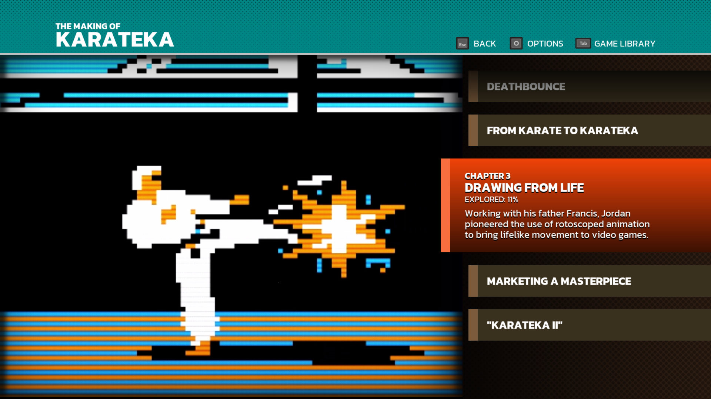
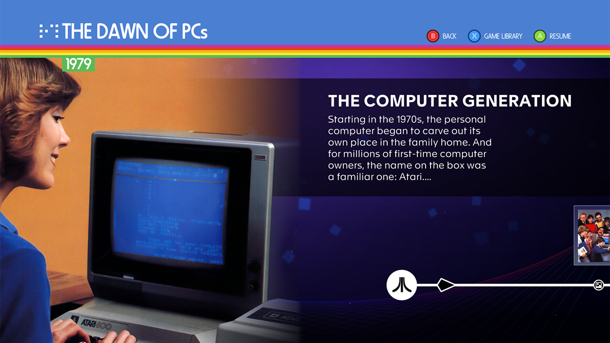
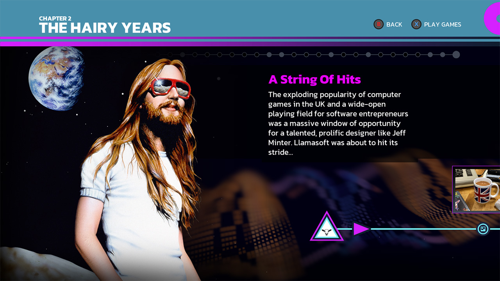
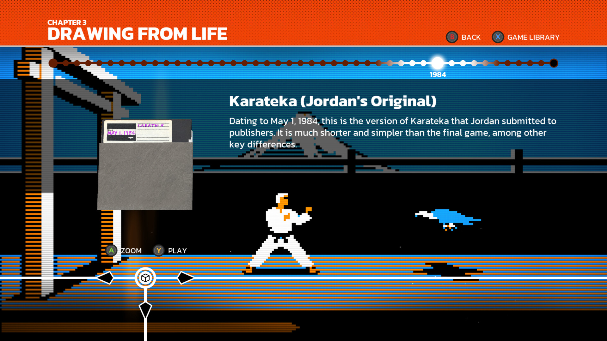
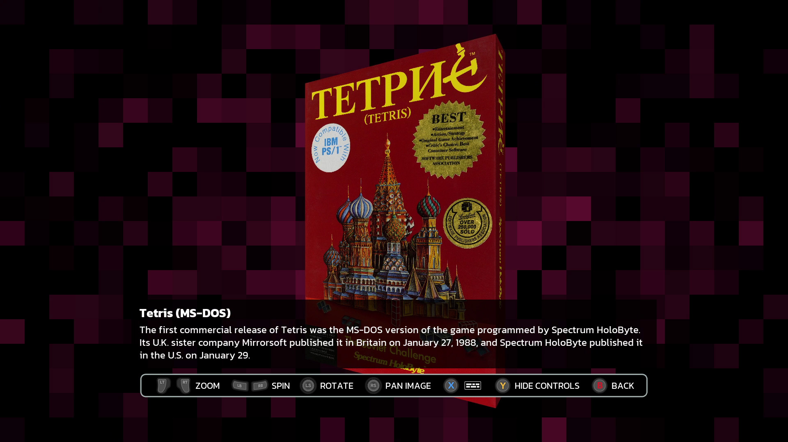

# Interactive documentary direction

Research pass: 20 October 2026. The screenshots below were retrieved from Digital Eclipse's official product galleries and its publisher-managed Steam page, opened as native image files and visually inspected. They are screenshots of the applications, not screenshots of the product websites. Local copies are research references only; they are not Pixel Museum runtime assets.

The strongest common principle is a focused scene attached to a navigable historical route. The timeline is a place the viewer moves through. The image, object or person defines that place; the text explains the current stop. The rest of the interface stays subordinate.

## Five directly inspected references

### 1. The Making of Karateka — chapter selection

Official page: https://www.digitaleclipse.com/games/karateka

Direct publisher image: https://cdn.prod.website-files.com/63fe9c9ccd6a191fcb553ba6/64ac73e0abbf13d87825c308_makingofkarateka_web1.png

The left approximately two thirds is one huge piece of game imagery. The right is a vertical sequence of chapters. Unfocused chapters are narrow, single-line bars; the selected chapter expands to around three times that height and reveals a chapter number, title, progress and a concise description. Selection changes the composition's emphasis, not merely a border around an otherwise identical card. The title strip contains controller actions, not a website navigation menu.

**Translate to Pixel Museum:** an era/chapter entry scene should show one dominant image or object on the left and the seven eras as a compact sequence on the right. The selected era opens enough to reveal its period and invitation. On confirmation, enter that era's timeline. A long row of equally weighted article cards does not provide the same spatial hierarchy.

### 2. Atari 50 — a historical scene connected to a route

Official page: https://www.digitaleclipse.com/games/atari50

Direct publisher image: https://cdn.prod.website-files.com/63fe9c9ccd6a191fcb553ba6/643090c7eaf56535c3d2fa3e_atari50_3.png

A historical photograph fills the left side and bleeds into the full scene. The current title and a short introductory paragraph occupy the upper right. The timeline sits near the bottom and continues beyond the right edge. A large origin/section marker, a directional chevron, a small item-type node and a thumbnail above a later node make the route readable. The rail is part of the scene rather than a full-width row of large rectangular cards. A year is attached to the scene's historical context.

**Translate to Pixel Museum:** keep the focused exhibit large and give its text a stable reading zone. Show only small neighbouring artifacts near the rail so the viewer knows another stop is available. Leave the route visibly continuing beyond the frame. A faint parallax field can connect the photograph and rail, but the photograph must remain legible and the rail must keep its geometry.

### 3. Llamasoft — chapter identity, overview and local focus

Official page: https://www.digitaleclipse.com/games/llamasoft

Direct publisher image: https://cdn.prod.website-files.com/63fe9c9ccd6a191fcb553ba6/656fc3a42b7d9c5a16e4c617_Llamasoft_web_05.jpg

The large cut-out portrait is an inhabitant of the scene rather than a photo inside a conventional card. The current explanation is upper right. A row of small dots near the top gives a chapter-wide overview, while the bottom rail shows local context. Its triangular chapter marker is different from the circular image node. A neighbour's framed thumbnail is suspended above its node. Filled and outlined dots visibly distinguish states, although a still image alone cannot prove the exact state rules.

**Translate to Pixel Museum:** use two scales: a quiet chapter overview plus a small number of immediate neighbouring stops. Give people, machines and images different scene treatment. Encode an item's media type with a small clear icon inside its rail node. Do not assume a filled dot means completed unless Pixel Museum actually records that state. Keep the selected person's silhouette large when source imagery supports a genuine cut-out; do not manufacture one from a badly cropped portrait.

### 4. The Making of Karateka — a selected artifact and a visible branch

Publisher-managed Steam page: https://store.steampowered.com/app/1163060/The_Making_of_Karateka/

Direct publisher-distributed screenshot: https://shared.akamai.steamstatic.com/store_item_assets/steam/apps/1163060/ss_e3737c9c8d23bf157fe045ec799e0de479f88c79.1920x1080.jpg

The floppy disk is a large artifact on the left. Its explanation sits at the top right, with the underlying game art filling the space. A chapter-wide row of small nodes shows the current year with an enlarged luminous focus. Near the bottom, the current node has a cube/object icon and clear left/right directional marks. A vertical connector and down direction indicate a branch away from the main route. The artifact offers contextual actions immediately beside it: inspection and play. The image makes branching tangible rather than hiding every option inside a generic popup menu.

**Translate to Pixel Museum:** left/right should move along the historical sequence; a real attached branch can offer images, a video screening, an object model or a related exhibit. The branch must correspond to actual available content. Do not draw decorative exits to nothing. The selected node can expand and glow while the two nearest route nodes remain subdued. Put the actions the exhibit supports near its artifact; a machine with a model should offer inspection, while a screening should offer playback.

### 5. Tetris Forever — artifact inspection as a dedicated mode

Official page: https://www.digitaleclipse.com/games/tetrisforever

Direct publisher image: https://cdn.prod.website-files.com/63fe9c9ccd6a191fcb553ba6/672180e35cdc59c6ab1c7324_TF_web01.jpg

The box occupies most of the view, with a short caption over a translucent lower field and controller instructions along the bottom. The available interactions explicitly include zoom, spin, rotation and panning. The historical object is allowed to dominate; the timeline is not kept on screen at the expense of inspection. The screenshot also shows that contextual controls can be hidden.

**Translate to Pixel Museum:** confirmation on an image/model should transition into a real inspection mode. Keep the artifact centred, preserve its aspect ratio, allow zoom/pan or rotation as appropriate and let the controls disappear. Returning should restore the previous timeline focus and camera position. Do not shrink the timeline and inspection viewer into competing website panels.

## Concrete spatial system for the redesign

These proportions are Pixel Museum implementation suggestions inferred from the screenshots, not measurements claimed by Digital Eclipse.

1. **Chapter entry:** one atmospheric scene; dominant object/photograph on the left, compact chapter selection on the right. The selected chapter expands. Resume, if implemented, is a real saved position.
2. **Timeline scene:** one exhibit supplies the primary artwork. Its short title and introduction occupy a predictable reading area. The chronological rail lives in the lower fifth, with nearby artifacts anchored to nodes rather than boxed into an article grid.
3. **Two navigation scales:** L1/R1 can change chapter; left/right chooses a stop inside it. A small sequence of chapter marks or node dots communicates position without consuming a website-style header.
4. **Focus is spatial:** the active node grows; a line, halo or luminance change connects it to its artifact. Non-active nodes and thumbnails are quieter. Every motion ends with the active image, node and description aligned.
5. **Branches mean content:** up/down can enter actual media or related-object branches. Use film, photograph, document and object symbols, not an invented hierarchy of historical importance.
6. **Separate modes:** reading, screening, image inspection and object inspection deserve their own compositions. Back restores the previous scene, not the start of the museum.
7. **Motion:** use a short eased camera translation between focused stops, with less movement in the distant backdrop. Do not move the reading area independently or oscillate focused content. A still screenshot verifies the layering and composition; animation timing must be tested in Pixel Museum itself.
8. **Typography and atmosphere:** retain the user's restrained museum typography and colour judgement, but use deep backgrounds, large subject imagery and a small accent on the route. A Scandinavian museum reference can guide restraint without importing website headers, search bars, pill navigation or catalogue-grid proportions into the main experience.

## What to carry forward, and what to adapt

Carry forward chapter-based progression, an explorable route, media-specific nodes, distinct entry/inspection modes, large contextual imagery, controller-first focus and a reliable return position. The important resemblance is how the experience is navigated and staged, not the use of a particular font, bright coloured title bar or decorative scanline.

The historical connections in Pixel Museum's current catalog remain useful. The redesign can use the existing `era_id`, `kind`, `related_ids`, `images`, `videos` and `models`. This research pass does not alter that catalog, rename entries or invent new media.

All screenshots remain copyrighted by Digital Eclipse/Atari and their respective depicted rights holders. They are retained here solely as attributed design-research references. They should not be copied into the app's own backgrounds or presented as Pixel Museum screenshots.
